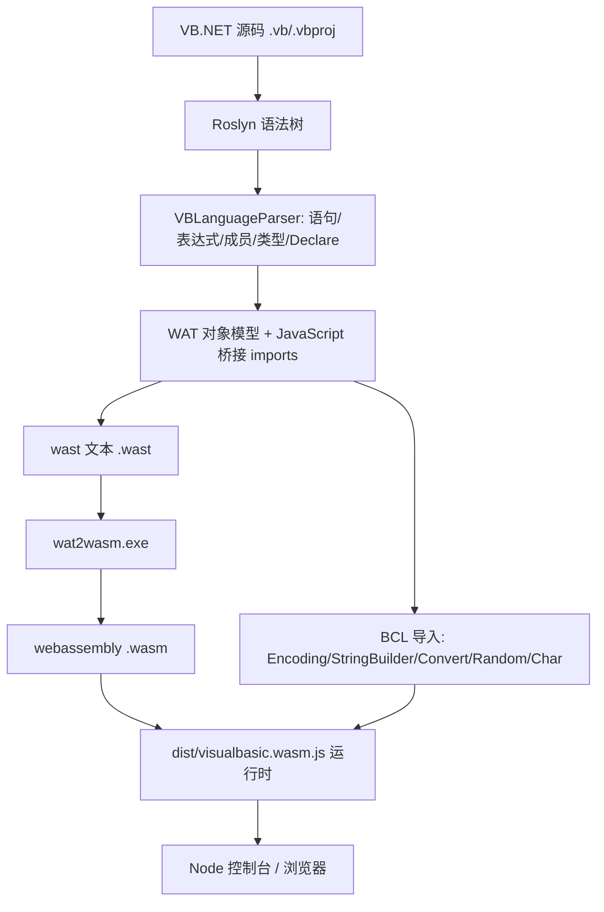

## 产品概述

将 `g:/vanilla` 的 VB.NET→WebAssembly 编译器前端补全：修复 `src\Roslyn\Roslyn.vbproj` 中的语法解析器，使其能够解析较完整的 VB.NET 语法集合；随后用修复后的编译器编译 `test\base64\base64.vbproj` 为 WebAssembly，并在 Node.js 控制台运行，输出与 .NET 命令行程序一致的 Base64 编解码结果。

## 核心功能

- 语法前端补全：语句层（局部变量/常量声明、赋值与复合赋值、While、Do/Loop、Exit、Throw、单行 If、Call/表达式语句）、表达式层（对象创建、数组创建、集合字面量、元素访问、括号、三元 If、字符字面量、Nothing、幂运算、类型转换）、成员访问（.NET 成员到 JS 桥接的映射）、类型声明层（Module/Class/Structure/Enum/Namespace）、Declare 语句与模块级全局字段。
- BCL 运行时桥接：以 JS 导入方式提供 Encoding.UTF8 编解码、StringBuilder、Convert、Random、Char/String 等能力；核心算术、数组与位运算仍在 wasm 内执行。
- 验收标准 A：`test\test` 中全部 37 个 `.vb` 文件都能生成对应 `.wast` 文本源文件，并通过 `wat2wasm` 成功编译为 `.wasm`（以“可编译”为准，不要求运行期语义全部正确）。
- 验收标准 B：编译 `test\base64\base64.vbproj` 为 `.wasm`，在 Node 中运行，固定样例（"Man"/"Ma"/"M"/"你好，Base64！"/空串）的 Base64 编码与解码结果与 .NET 完全一致（不要求实现 .NET 带种子 Random）。

## 技术栈

- 编译器前端：VB.NET（net10.0）+ Roslyn 5.9（`Microsoft.CodeAnalysis.VisualBasic`），解析为表达式树。
- 编译器后端：现有 `src\WAT\WAT.vbproj`（表达式树 → wast 对象 → wast 文本）。
- 依赖框架：GCModeller sciBASIC#（`Microsoft.VisualBasic.Core`、`VisualStudio.NET5`，路径 `..\..\..\GCModeller\src\runtime\sciBASIC#\...`）。
- wasm 编译：`G:\vanilla\dist\tools\wat2wasm.exe`（wabt）。
- 运行时与验证：`dist\visualbasic.wasm.js`（ES2020，浏览器/Node 通用）+ Node.js（原生 `WebAssembly`/`TextDecoder`）。

## 实现方案

在既有 v2 运行时契约（导入/导出名称与签名保持不变）之上，采用“前端补全 + 后端补对象模型 + 运行时补 BCL 导入”的三段式策略：

1. **前端补全（src/Roslyn/VBLanguageParser、Scanner）**：把 `LineParser`/`ExpressionParser`/`MemberAccessParser`/`IfBlockParser`/`BinaryParser`/`DeclaratorParser` 中当前落到 `Throw New NotImplementedException` 的分支逐一实现；`Scanner.GetCodeModules` 由仅取 `ModuleBlockSyntax` 扩展为处理顶层 Module/Class/Structure/Enum/Namespace 与 `Declare` 语句。
2. **后端补对象模型与 BCL（src/WAT）**：扩展 `TypeSchema` 支持用户类型的字段布局与构造；新增 `JavaScript\*.vb` 桥接类（仿照 `JavaScript.Console/Math` 的 `Public Declare ... Lib "module" Alias "entry"` 反射注册机制）并在 `Workspace.Sub New` 注册；`SExpressionEngine` 输出对应 imports。
3. **运行时补导入（dist）**：在 `dist/visualbasic.wasm.js` 与 `.min.js` 内实现新增 BCL 导入（UTF-8、StringBuilder、Convert、Random、Char），核心算法仍在线性内存内由 wasm 完成。

### 关键决策与权衡

- **保持 wasm 接口稳定**：不破坏上一轮已修复并验证的 v2 契约与 4 个缺陷修复（AssemblyInfo 字段导出、比较指令按操作数类型、内存字符串对齐、vbproj 轻量回退），新增能力以“新增 import 名称”方式追加，避免回归。
- **BCL 走 JS 桥接（用户已确认）**：UTF-8 编解码、StringBuilder、Convert、Random 在 JS 侧实现并读写线性内存，既能快速与 .NET 语义对齐，又避免在 wasm 内实现重量级字符串/编码逻辑。代价是运行时导入面与体积变大。
- **test/test 以可编译为准（用户已确认）**：Dictionary、GC、结构体值拷贝等难特性允许用占位/简化实现，只需生成合法 wast。
- **base64 只用固定样例比对（用户已确认）**：不实现 .NET 带种子 Random，但 Program.vb 的随机交叉验证代码仍会执行，因此 Random/Convert/Encoding/StringBuilder/ChrW 必须可运行且“自洽”。

### 性能与可靠性

- 对象在 wasm 线性内存中以“类 id + 字段偏移”紧凑布局表示；数组沿用现有 `Array.*` 线性内存块表示，元素访问通过 wast 的 `i32.load/f64.load` 直接完成，避免边界往返。
- UTF-8 编解码只在“文本层”发生一次（`Encoding.UTF8.GetBytes/GetString`），核心 Base64 分组与位运算完全在 wasm f64/i32 上执行。
- 编译驱动对每个测试文件独立执行并按 exit code 断言，失败文件输出可定位的诊断信息，避免单点失败污染整批。

## 实现要点

- **CLI 调用约定**：必须使用绝对路径（`& "G:\vanilla\src\vanilla\bin\Debug\net10.0\vanilla.exe" "<abs>.vb" /out "<abs>.wasm"`），相对路径会把产物写到进程 CWD。
- **契约冻结**：新增导入以独立 module 名与签名追加，不改动既有 `Math/console/string/GC/document/Array/Strings/RegExp/env.bytechunks` 的名称与签名。
- **内存布局**：字符串常量低地址，运行时 bump 分配器自高向低；新增 BCL 产生的数组/对象须与 `Array`/`ObjectManager` 约定一致，避免与既有数据段重叠（上一轮已修 `MemoryBuffer` 对齐缺陷，勿回退）。
- **错误处理**：解析器遇到暂不支持的语法时，优先尝试“可编译的降级表示”（占位/桩），仅在确实无法生成合法 wast 时才抛出带语法节点类型的异常，便于批量清单定位。
- **blast radius**：不改动 `dist` 既有导入实现；新 BCL 导入以新增方式加入；`test/test` 与 `test/base64` 产物输出到独立目录，不改动既有测试工程。

## 系统架构



## 目录结构

```
g:/vanilla/
├── src/Roslyn/
│   ├── Scanner.vb                              # [MODIFY] 顶层非 Module 块、Declare 语句、模块级字段
│   └── VBLanguageParser/
│       ├── LineParser.vb                       # [MODIFY] Dim/Const、赋值/复合赋值、While、Do/Loop、Exit、Throw、单行 If
│       ├── ExpressionParser.vb                 # [MODIFY] 对象/数组创建、集合字面量、元素访问、括号、三元 If、字符字面量、Nothing、幂
│       ├── MemberAccessParser.vb               # [MODIFY] 通用成员访问 + .NET→JS 桥接映射
│       ├── BinaryParser.vb                     # [MODIFY] ^ / \ / Mod / 位运算 / 字符比较
│       ├── IfBlockParser.vb                    # [MODIFY] ElseIf 链
│       ├── DeclaratorParser.vb                 # [MODIFY] AsNew、数组初始化、多声明符
│       ├── DeclareStatementParser.vb           # [NEW] Declare Sub/Function Lib "..." Alias "..." 语句
│       └── TypeBlockParser.vb                  # [NEW] Class/Structure/Module/Namespace/Enum 顶层块
├── src/WAT/
│   ├── CodeAnalysis/TypeSchema.vb              # [MODIFY] 用户类型字段布局/构造/属性
│   ├── JavaScript/Text.vb                      # [NEW] Encoding.UTF8 / StringBuilder / Char / String 导入定义
│   ├── JavaScript/Convert.vb                   # [NEW] Convert.ToBase64String / FromBase64String / 数值转换
│   ├── JavaScript/Random.vb                    # [NEW] Random.New / Next
│   ├── CodeAnalysis/Workspace/Workspace.vb     # [MODIFY] 注册新增 BCL 桥接
│   └── Compiler/SExpression/SExpressionEngine.vb# [MODIFY] 输出新增 imports / 类型元数据
├── dist/
│   ├── visualbasic.wasm.js                     # [MODIFY] 新增 BCL 导入实现（Encoding/StringBuilder/Convert/Random/Char）
│   └── visualbasic.wasm.min.js                 # [MODIFY] 同步精简版
└── test/
    ├── test/                                   # 验收 A：37 个 .vb → .wast/.wasm（批量脚本）
    └── base64/                                 # 验收 B：base64.vbproj → .wasm + node 运行脚本
```

## 关键接口（JS 侧需提供的 BCL 导入契约）

```js
// 追加到 dist/visualbasic.wasm.js 的 imports，供生成的 wasm 调用
imports.Encoding = {
  'UTF8.GetBytes' : (strPtr) => arrayPtr,   // UTF-8 编码：C 串 -> 线性内存字节数组指针
  'UTF8.GetString': (arrPtr) => strPtr      // UTF-8 解码：字节数组 -> C 串指针
};
imports.StringBuilder = { New: () => id, Append: (id, val) => id, ToString: (id) => strPtr };
imports.Convert       = { 'ToBase64String': (arrPtr) => strPtr, 'FromBase64String': (strPtr) => arrPtr };
imports.Random        = { New: (seed) => id, Next: (id, min, max) => i32 };
imports.Char          = { ChrW: (i32) => strPtr, 'NewString': (strPtr, n) => strPtr, Empty: () => strPtr };
```

（数组为线性内存块：`class_id` + `length` + 元素，沿用既有 `Array.*`，保证与核心算法在 wasm 内的元素访问兼容。）

## Agent Extensions

### SubAgent

- **code-explorer**
- Purpose: 对 `test\test` 的 37 个 `.vb` 文件与 `src\Roslyn\VBLanguageParser`、`src\WAT` 进行系统性语法特性与代码结构梳理，产出精确的“待实现语法清单/失败基线”。
- Expected outcome: 一份逐文件、逐语法节点的待实现清单与代码定位，作为后续分批实现的依据，避免遗漏。

### Skill

- **lsp-code-analysis**
- Purpose: 在补全解析器/生成器时进行语义级导航（查找定义、引用、实现、调用层级、文件大纲），精确评估改动影响面（如 `WATType`/`Environment`/`TypeSchema`/`LiteralValue` 的所有使用点）。
- Expected outcome: 准确的影响面清单与符号定位，降低跨文件改动导致的编译回归风险。