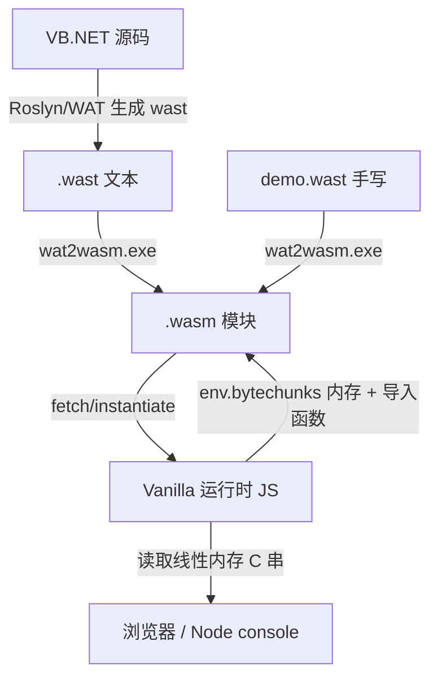

## 用户需求

- 破坏性重构 vanilla（VB.NET→WebAssembly）项目的 JavaScript 运行时，使其更轻量、在 web 环境运行效率更高。
- 重新设计 wasm 与 JS 运行时之间的契约，减少 JS↔WASM interop 往返，字符串在线性内存内直接操作。
- 重构完成后，手写一个 demo 程序（控制台输出 + 数学计算），用 `G:\vanilla\dist\tools\wat2wasm.exe` 编译为 wasm，在 web 环境中运行验证。
- 顺带清理/修复编译器（src/Roslyn、src/WAT、src/vanilla），使其可正常构建并能编译基础 VB 代码。

## 产品概述

重写 `dist/visualbasic.wasm(.min).js` 运行时，配套一套更轻量的运行时契约；产出可在浏览器/Node 中运行的 demo（控制台打印文本与数值、数学计算）。

## 核心特性

- 精简运行时：去除 closure 编译器填充 `$jscomp`；废除 JS 侧字符串/对象大字典缓存；去掉 GarbageCollection 的 Base64/JSON 类反射开销。
- 新契约：字符串统一以线性内存中 null 结尾的 UTF-8 C 串表示；JS 侧分配器把计算结果写回线性内存并返回内存指针，不再产生负 id 缓存。
- 兼容的导入/导出接口名（Math / console / string / GC / document / Array / env.bytechunks）保持与现有生成代码一致，确保 `test/HelloWorld.wast` 及编译器产物可直接链接运行。
- demo：控制台输出文本与数值、数学计算（π 近似、阶乘、三角函数、质数判定、数值累加）并用 `console.log` 打印；同时调用 `string.add`/`string.toString` 验证线性内存字符串路径。

## Tech Stack

- 运行时：`dist/visualbasic.wasm.js`（纯 JavaScript，ES2020+，无转译、无闭包填充），浏览器 + Node.js 双环境通用。
- wasm 编译：`G:\vanilla\dist\tools\wat2wasm.exe`（wabt 工具链）。
- demo 验证：Node.js（原生 `WebAssembly` + `TextDecoder` + `console`），无头运行并断言数学结果。
- 编译器（清理/修复）：VB.NET（net10.0），Roslyn 5.9，依赖 GCModeller sciBASIC#（Microsoft.VisualBasic.Core、VisualStudio.NET5）。

## Implementation Approach

### 策略

保持 wasm 模块的「导入/导出名称与类型签名」完全不变（与 `test/HelloWorld.wast` 逐字一致），仅重写 JS 运行时内部语义以消除 interop 开销。这样现有生成代码与编译器（Roslyn/WAT）几乎无需改动即可链接运行，风险可控。

### 关键决策与权衡

1. **统一指针空间到线性内存**：废除旧 `ObjectManager` 的 `h`（负 id 字符串缓存）、`e`（JS 对象缓存）大字典。`string.add/replace/toString` 等导入改为「读内存 C 串 → 计算 → JS 侧 bump 分配器写入线性内存动态区 → 返回内存指针」，不再生成 `-999999999` 起的负 id。这是主要性能来源（每次字符串操作不再往返 JS 字典）。
2. **JS 持有线性内存**：`env.bytechunks` 仍由 JS 提供 `WebAssembly.Memory`；运行时维护一个 bump 指针 `_heap`（从 `global.GetMemorySize` 给出的已用大小之后开始），写入新串前检查越界并 `memory.grow`，无需新增 wasm 导入。
3. **废除 GC 反射**：`GC.addObject` 设为 no-op 空函数（保留导入名以便链接）；删除 `GarbageCollection` 的 Base64+JSON 类元数据解析；`AssemblyInfo.*` 直接返回静态字符串指针。
4. **去除闭包填充**：删除 `$jscomp` 段，运行时挂到独立命名空间 `window.Vanilla`（不污染原生 `WebAssembly` 全局）。
5. **精简导入装配**：`TextDecoder` 单实例读取内存字符串；`console.*` 直接读内存串打印；`document.*` 提供安全 stub（demo 不依赖）；`Array.*` 用 JS 数组精简实现。

### 性能与可靠性

- 边界调用由「每次字符串操作往返 JS 字典 + 编码」降为「读内存 + 写内存」，且无 JS 对象分配；demo 数学计算 100% 在 wasm 内（f64），仅打印时发生一次边界调用。
- 单一 `TextDecoder` 实例复用，避免重复构造；`_heap` 分配 O(1)，`memory.grow` 仅在溢出时发生。
- 现代浏览器与 Node 共用同一份运行时，`RunAssembly` 接受 URL 或 `ArrayBuffer`/字节数组，便于无头测试。

## Implementation Notes

- **契约冻结**：导入名/签名严格照搬 `test/HelloWorld.wast`：`Math{pow,sqrt,exp,cos,random,ceil,floor}`、`GC{addObject}`、`string{replace,add,length,indexOf,toString}`、`console{log,warn,info,error}`、`document{getElementById,writeElementText,createElement,setAttribute,appendChild}`、`Array{create,push,get,set,length}`、`(memory (import "env" "bytechunks") 1)`；导出 `global.GetMemorySize`、`App.RunApp`、`AssemblyInfo.*` 不变。
- **内存布局**：字符串常量由 wasm `data` 段放在低地址（如 13..），`global.GetMemorySize` 给出初始已用大小；`_heap` 从该值之后 bump 分配；写入前检测越界并 `memory.grow`，写入格式为「UTF-8 字节 + 0x00 结尾」。
- **向后兼容**：编译器（Roslyn/WAT）若切换新版运行时，仅替换 `dist` 脚本即可，无需改动其 import 发射（接口名一致）。
- **日志/测试**：Node 测试 `run.mjs` 拦截 `console.*` 输出做断言，不 dump 大块内存；断言项含 π 近似误差、阶乘值、三角函数值、质数判定结果。
- **blast radius**：不改动 `test/HelloWorld.wast` 等既有产物；新版 runtime 与旧版并行（先新增可读 `visualbasic.wasm.js`，再覆盖 `visualbasic.wasm.min.js`）。

## Architecture Design



运行时内部模块：`Vanilla.memory`（持有 `WebAssembly.Memory` + `_heap` bump 分配 + `TextDecoder` 读串）、`Vanilla.imports`（组装 Math/console/string/GC/document/Array/env）、`Vanilla.run(urlOrBytes, opts)`（实例化并调用 `App.RunApp`，支持 console 捕获）。

## Directory Structure

```
g:/vanilla/
├── dist/
│   ├── visualbasic.wasm.js        # [REWRITE] 可读版新运行时源（主文件），实现 Vanilla 命名空间、内存读取/分配、导入装配、run 入口
│   └── visualbasic.wasm.min.js    # [REWRITE] 精简后运行时（覆盖旧文件），无 closure 填充
├── test/
│   └── demo_v2/
│       ├── demo.wast              # [NEW] 手写 demo：console 输出文本/数值 + 数学计算（π近似、阶乘、sin/cos、质数）+ string.add/toString 验证
│       ├── demo.wasm              # [NEW] wat2wasm.exe 编译产物
│       ├── index.html             # [NEW] 浏览器运行页，引用新运行时并实例化 demo.wasm
│       └── run.mjs                # [NEW] Node 无头测试：加载运行时+wasm、捕获 console、断言数学结果、打印性能计时
└── src/
    ├── WAT/                       # [MODIFY] 编译器清理/修复，维持 v2 契约（导入接口名不变），使其可构建
    ├── Roslyn/                    # [MODIFY] 同上，必要时修正 import 发射与 ObjectManager 生成
    └── vanilla/Program.vb         # [MODIFY as needed] CLI 入口清理，保持 CreateWasm 流程
```

## Key Code Structures

运行时核心契约（JS 侧需向 wasm 提供的导入对象，必须匹配 wast 签名）：

```js
// Vanilla runtime 向 wasm 实例注入的 imports 结构（名称/签名与 HelloWorld.wast 一致）
const imports = {
  env: { bytechunks: memory },                 // (memory (import "env" "bytechunks") 1)
  Math: { pow, sqrt, exp, cos, random, ceil, floor },   // f64 -> f64
  GC:   { addObject: () => {} },               // no-op，仅保留链接
  string: { replace, add, length, indexOf, toString },  // 读内存 C 串，结果写回 _heap 返回指针
  console:{ log, warn, info, error },          // 读内存 C 串后打印
  document:{ getElementById, writeElementText, createElement, setAttribute, appendChild }, // 安全 stub
  Array: { create, push, get, set, length }    // JS 数组精简实现
};
// 入口：Vanilla.run(bytesOrUrl, { run }) -> 实例化后调用 App.RunApp 并回调 run(app)
```