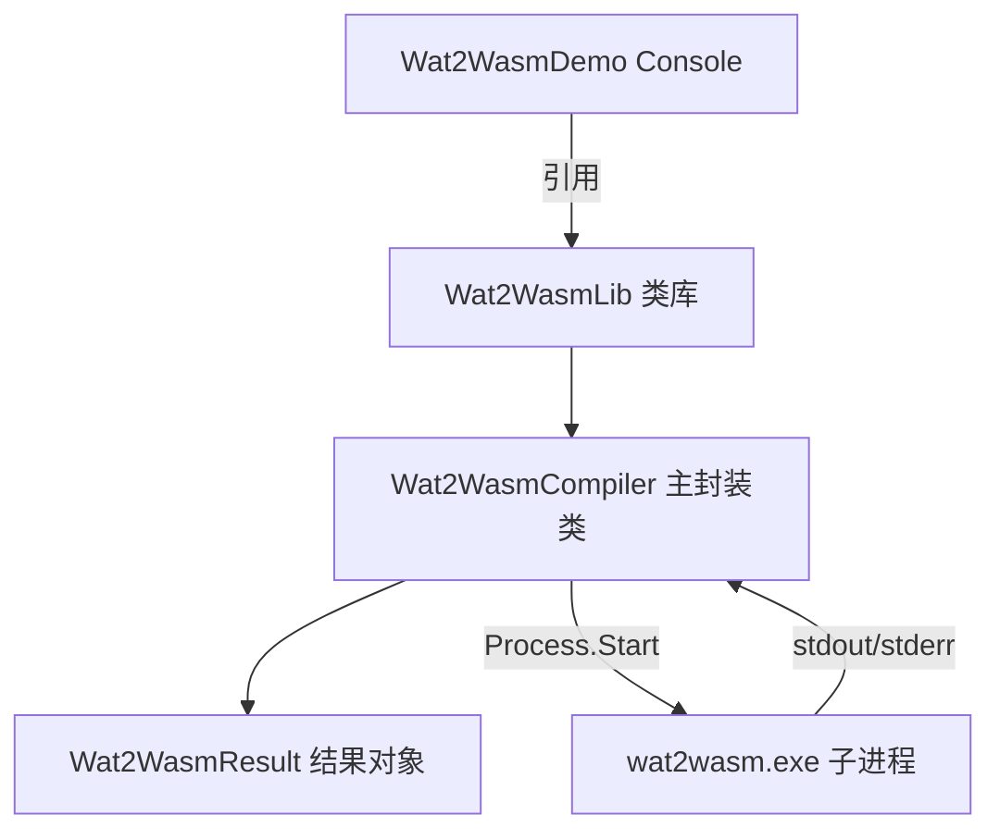

## 用户需求

在 `g:/vanilla/dist/tools` 目录中，使用 VB.NET（.NET 10.0 运行时）为 `wat2wasm.exe`（WABT 的 WebAssembly 文本格式编译器）实现一个命令行封装类库，并附带一个可运行的控制台 Demo 演示程序。

## 产品概述

封装类库 `Wat2WasmLib` 提供 `Wat2WasmCompiler` 类，通过属性设置 `wat2wasm.exe` 的全部命令行参数，启动进程并捕获标准输出（stdout）与标准错误（stderr），再通过若干函数提供不同种类的功能封装（普通编译、模块转储、Verbose 编译、帮助查询）。Demo 程序演示如何设置属性、调用函数并读取产物与输出。

## 核心特性

- 通过可读属性覆盖 `wat2wasm.exe` 的全部命令行开关（verbose 次数、dump-module、debug-parser、各 enable-/disable- 特性开关、output 输出路径、relocatable、no-canonicalize-leb128s、debug-names、no-check）。
- 启动 `wat2wasm.exe` 子进程，重定向并捕获 stdout / stderr 文本，避免双向管道死锁。
- 提供功能封装函数：`Compile`（编译为 .wasm 文件）、`DumpModule`（开启模块转储并捕获 stdout 十六进制内容）、`VerboseCompile`（指定 verbose 级别编译）、`GetHelp`（返回帮助文本）。
- 结果对象 `Wat2WasmResult` 暴露退出码、标准输出、标准错误、是否成功、输出文件路径。
- 产物（.wasm 二进制）仅通过 `-o` 输出文件路径暴露，由调用方读取文件，封装类不自动读回字节数组、不支持内存文本输入。
- 控制台 Demo 演示完整调用流程并验证生成的 .wasm 文件存在。

## 技术栈

- 语言：VB.NET（Visual Basic，.NET 10.0）
- 运行时/框架：`net10.0`（类库），`net10.0`（Console 演示，Windows 平台）
- 进程调用：`System.Diagnostics.Process` + `ProcessStartInfo`（重定向 stdout/stderr）
- 工程系统：SDK 风格 `.vbproj`（dotnet CLI 构建）

## 实现方案

### 总体策略

新建两个 SDK 风格 VB.NET 工程：类库 `Wat2WasmLib`（核心封装）与控制台 `Wat2WasmDemo`（演示）。主类 `Wat2WasmCompiler` 以属性映射所有命令行开关，通过 `BuildArguments()` 生成参数列表；`RunInternal(inputFile)` 负责进程启动、异步读取 stdout/stderr、超时控制，并返回 `Wat2WasmResult`。各功能函数是对 `RunInternal` 的属性预设 + 调用封装。

### 关键技术决策

1. **属性映射全部选项**：依据实测 `--help` 输出，把每个开关映射为 `Boolean`/`Integer`/`String` 属性。`-v/--verbose` 支持多次，用 `VerboseCount As Integer` 属性，构建时对 `VerboseCount` 循环拼接 `-v`。`--output`/`-o` 用 `OutputFile` 属性。
2. **异步读取避免死锁**：`RedirectStandardOutput/Error = True`、`UseShellExecute = False`、`CreateNoWindow = True`，使用 `Process.BeginOutputReadLine` + `OutputDataReceived` / `ErrorDataReceived` 事件异步累积文本（而非同步 `ReadToEnd`，否则在大数据输出时易死锁）。`WaitForExit` 后再 `WaitForExit(可选 TimeoutMs)`。
3. **结果对象与成功判定**：`Wat2WasmResult` 持有 `ExitCode`、`StandardOutput`、`StandardError`、`Success`（ExitCode=0 且 StandardError 为空）、`OutputFile`。调用方据 `Success` 与 `OutputFile` 自行读文件。
4. **ExecutablePath 默认与 Demo 可用性**：`ExecutablePath` 默认 `"wat2wasm.exe"`（依赖 PATH 或进程工作目录）。Demo 通过构建后复制（`<None CopyToOutputDirectory>` 或 `dotnet build` 后事件）把 `wat2wasm.exe` 拷到输出目录，保证默认路径即可运行。
5. **超时与资源清理**：提供 `TimeoutMs`（默认如 30000）。`Using` 包裹 `Process`，`EnableRaisingEvents=True`，出异常时 `Kill` + 释放，避免句柄泄漏。

### 性能与可靠性

- 异步读取 + 事件累积，复杂度 O(输出字节数)，无额外遍历；无 N+1 或重复 I/O。
- 进程仅短生命周期，内存/句柄开销极小；超时防止挂死。
- 不缓存编译产物，stateless 调用，线程安全以调用方保证（每实例独立 Process）。

## 实现备注

- **避免 VB 陷阱**：属性/方法名避免与保留字冲突（不使用 `Set` 作为名称）；若需数学函数全限定 `System.Math.xxx`；`Module` 成员不可 `Shared` 遮蔽 `System.Math`（本任务主要用字符串/集合，风险低，仍需注意）。
- **Blast radius**：仅新增工程与文件，不改动 `wat2wasm.exe` 及现有 tools 文件；保持向后兼容（默认属性保持关闭/空，等价于无额外参数调用）。
- **日志**：不在类内部做文件日志，仅把 stdout/stderr 透传给 `Wat2WasmResult`，方便调用方诊断。

## 架构设计

### 组件关系



- 数据流：调用方设置 `Wat2WasmCompiler` 属性 → `BuildArguments()` 生成参数 → 启动 `wat2wasm.exe` → 异步读取 stdout/stderr → 返回 `Wat2WasmResult`（含 OutputFile）。

## 目录结构

```
g:/vanilla/dist/tools/
├── Wat2WasmLib/                         # [NEW] net10.0 VB.NET 类库工程
│   ├── Wat2WasmLib.vbproj               # [NEW] 类库工程文件，TargetFramework=net10.0，输出 DLL
│   ├── Wat2WasmCompiler.vb              # [NEW] 主封装类。属性映射全部命令行开关；BuildArguments() 拼参；RunInternal() 启动进程+异步读 stdout/stderr+超时；功能函数 Compile/DumpModule/VerboseCompile/GetHelp 均返回 Wat2WasmResult。
│   └── Wat2WasmResult.vb               # [NEW] 结果对象。字段 ExitCode/StandardOutput/StandardError/Success/OutputFile，提供只读属性与构造器。
└── Wat2WasmDemo/                        # [NEW] net10.0 VB.NET 控制台演示工程
    ├── Wat2WasmDemo.vbproj             # [NEW] 控制台工程，ProjectReference 引用 Wat2WasmLib；构建后复制 wat2wasm.exe 到输出目录。
    ├── Program.vb                      # [NEW] 入口。写入示例 .wat（导出 add 函数的简单 module），设置属性，调用 Compile/VerboseCompile/DumpModule/GetHelp，打印结果并验证 .wasm 文件存在。
    └── Samples/                        # [NEW] 演示用样例目录（可选），含 example.wat 示例文本。
```

## 关键代码结构

```
' Wat2WasmCompiler 公开成员（接口级，无实现体）
Public Class Wat2WasmCompiler
    Public Property ExecutablePath As String = "wat2wasm.exe"
    Public Property WorkingDirectory As String = ""
    Public Property OutputFile As String = ""          ' -o / --output
    Public Property VerboseCount As Integer = 0         ' -v 重复次数
    Public Property DumpModule As Boolean = False       ' -d / --dump-module
    Public Property DebugParser As Boolean = False      ' --debug-parser
    Public Property EnableExceptions As Boolean = False
    Public Property DisableMutableGlobals As Boolean = False
    Public Property EnableSaturatingFloatToInt As Boolean = False
    Public Property EnableSignExtension As Boolean = False
    Public Property EnableSimd As Boolean = False
    Public Property EnableThreads As Boolean = False
    Public Property EnableMultiValue As Boolean = False
    Public Property EnableTailCall As Boolean = False
    Public Property EnableBulkMemory As Boolean = False
    Public Property EnableReferenceTypes As Boolean = False
    Public Property EnableAnnotations As Boolean = False
    Public Property Relocatable As Boolean = False      ' -r / --relocatable
    Public Property NoCanonicalizeLeb128s As Boolean = False
    Public Property DebugNames As Boolean = False       ' --debug-names
    Public Property NoCheck As Boolean = False          ' --no-check
    Public Property TimeoutMs As Integer = 30000

    Public Function Compile(inputFile As String, Optional outputFile As String = "") As Wat2WasmResult
    Public Function DumpModule(inputFile As String, Optional outputFile As String = "") As Wat2WasmResult
    Public Function VerboseCompile(inputFile As String, level As Integer, Optional outputFile As String = "") As Wat2WasmResult
    Public Function GetHelp() As Wat2WasmResult
End Class

' Wat2WasmResult 公开成员（接口级）
Public Class Wat2WasmResult
    Public ReadOnly Property ExitCode As Integer
    Public ReadOnly Property StandardOutput As String
    Public ReadOnly Property StandardError As String
    Public ReadOnly Property Success As Boolean
    Public ReadOnly Property OutputFile As String
End Class
```

## Agent Extensions

（本任务无需使用额外的 Skill / MCP / SubAgent / Integration 扩展，故省略 extensions 标签。）