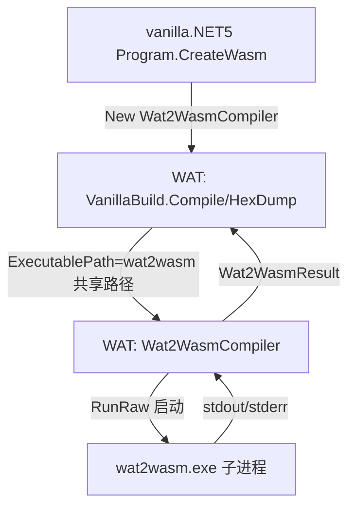

## 用户需求

将此前在 `G:/vanilla/dist/tools/Wat2WasmLib` 中实现的两个模块（`Wat2WasmCompiler.vb`、`Wat2WasmResult.vb`）合并进 `G:/vanilla/src/WAT/WAT.vbproj` 工程，替换掉该工程里原有的 wat2wasm.exe 命令行封装代码；与 wat2wasm.exe 命令行封装相关的旧代码（旧 `Wat2wasm` 类及其相关死代码）直接删除。改动完成后，编译 `G:/vanilla/src/vanilla/vanilla.NET5.vbproj`，确保其能够编译通过。

## 核心特性

- 把两个新模块并入 WAT 工程（置于 `VanillaBasic.WebAssembly.Compiler` 命名空间），对外提供进程调用封装与结果对象。
- 删除旧 `Compiler/Wat2wasm.vb`（基于 sciBASIC# `Argv`/CLI 框架、运行不正常的旧封装）与空壳 `Compiler/StandardOutput.vb`（旧封装相关死代码）。
- 改写旧封装的调用方 `Compiler/VanillaBuild.vb` 与 `vanilla/Program.vb`，改用新的 `Wat2WasmCompiler`（自包含进程启动、stdout/stderr 异步捕获、超时控制），保持既有公开方法返回 `String` 以兼容。
- 最终验证 `vanilla.NET5.vbproj` 编译通过（WAT 与 vanilla 均无误）。

## 技术栈

- 语言：VB.NET（.NET 10.0）
- 进程调用：`System.Diagnostics.Process` + `ProcessStartInfo`（重定向 stdout/stderr、异步读取、超时 Kill）
- 既有依赖：WAT 工程依赖 sciBASIC# 的 `Microsoft.VisualBasic.Core` 与 `VisualStudio.NET5`（提供 `App.ProductSharedDIR`、`TempFileSystem`、`SaveTo`、`CLIPath` 等扩展）

## 实现方案

### 总体策略

把新封装类作为 `WAT` 工程 `Compiler/` 目录下的两个新文件并入，使其与现有 `VanillaBuild` 同处 `VanillaBasic.WebAssembly.Compiler` 命名空间；删除旧的 `Wat2wasm` 类与空壳 `StandardOutput` 类；将 `VanillaBuild`/`Program.vb` 中对旧类的引用改写为使用 `Wat2WasmCompiler`。新类自包含运行进程，不再依赖 sciBASIC# 的 `CommandLine.Call` 与 `Argv` 框架。

### 关键技术决策

1. **命名空间对齐**：新文件使用 `Namespace VanillaBasic.WebAssembly.Compiler`，与旧 `Wat2wasm` 同命名空间，`VanillaBuild` 与 `Program.vb`（已 `Imports VanillaBasic.WebAssembly.Compiler`）可直接引用，无需额外 import。
2. **进程运行自包含**：`Wat2WasmCompiler.RunRaw` 用 `UseShellExecute=False`、`RedirectStandardOutput/Error=True`、`BeginOutputReadLine/BeginErrorReadLine` 异步累积，避免双向管道死锁；`WaitForExit(TimeoutMs)` 超时则 `Kill` 并补记错误信息。
3. **调用方最小改动**：`VanillaBuild.Compile/HexDump/CompileWast` 仍返回 `String`（stdout/失败时为 stderr），仅把内部 `New Wat2wasm`+`CommandLine.Call` 替换为构造 `Wat2WasmCompiler`、`ExecutablePath = wat2wasm`（共享路径）、调用 `.Compile`/`.DumpModule` 并取 `Wat2WasmResult.StandardOutput`/`StandardError`。`WastDump` 保持不变。
4. **适配冲突规避**：`RunInternal` 中的 `Path.ChangeExtension` 改为 `System.IO.Path.ChangeExtension`，避免与 sciBASIC# 中可能的 `Path` 类型冲突；文件顶部保留 `Imports System.Diagnostics/System.Text/System.IO/System.Collections.Generic`。
5. **删除范围控制**：仅删除确属旧封装的 `Compiler/Wat2wasm.vb` 与无引用空壳 `Compiler/StandardOutput.vb`，不改动 `VanillaBuild` 的资源释放/静态检查逻辑（仍确保 `wat2wasm.exe` 已释放）。

### 性能与可靠性

- 异步事件累积复杂度 O(输出字节数)，无额外遍历；进程短生命周期，`Using` 包裹 `Process` 保证句柄释放；超时防止挂死。
- 不缓存产物，按调用无状态执行；`ExecutablePath` 由 `VanillaBuild` 统一设为已释放的 `wat2wasm` 绝对路径。

### 实现备注

- VB 陷阱：属性/方法名避免保留字冲突（已确认无 `Set` 等）；若需数学函数全限定 `System.Math.xxx`（本任务主要为字符串/集合，风险低）。
- Blast radius：仅新增 2 个文件、删除 2 个文件、改写 2 处调用方；不动 `Roslyn`/Core/VisualStudio.NET5 功能代码。Roslyn 虽引用 WAT 但未使用 `Wat2wasm` 类，不受影响。
- `WAT.vbproj` 开启 `GeneratePackageOnBuild` 会生成 nupkg（既有的 LICENSE 引用行为），不影响编译验收。

## 架构设计



## 目录结构

```
G:/vanilla/src/WAT/
├── Compiler/
│   ├── Wat2WasmCompiler.vb   # [NEW] 新封装主类。命名空间 VanillaBasic.WebAssembly.Compiler；全部命令行属性映射；RunInternal/BuildArguments/RunRaw 进程启动与异步读取；方法 Compile/DumpModule/VerboseCompile/GetHelp。Path.ChangeExtension 用全限定名。
│   ├── Wat2WasmResult.vb     # [NEW] 新结果对象。只读属性 ExitCode/StandardOutput/StandardError/OutputFile/Success；构造器填充并判定 Success。
│   ├── Wat2wasm.vb           # [DELETE] 旧封装类（基于 Argv/CLI 框架，运行不正常），删除。
│   ├── StandardOutput.vb     # [DELETE] 空壳旧封装相关死代码，无引用，删除。
│   └── VanillaBuild.vb       # [MODIFY] 去掉 Wat2wasm/CommandLine.Call 依赖；HexDump/Compile/CompileWast 改构造 Wat2WasmCompiler(ExecutablePath=wat2wasm)、调用 .DumpModule/.Compile、取 Wat2WasmResult 文本；签名 config As Wat2wasm → compiler As Wat2WasmCompiler；返回类型保持 String；WastDump 不变。
G:/vanilla/src/vanilla/
└── Program.vb                # [MODIFY] CreateWasm 扩展中将 New Wat2wasm With {.output=...} 改为 New Wat2WasmCompiler With {.OutputFile=...}（debug 时设 DebugNames/DebugParser/VerboseCount），其余调用不变。
```